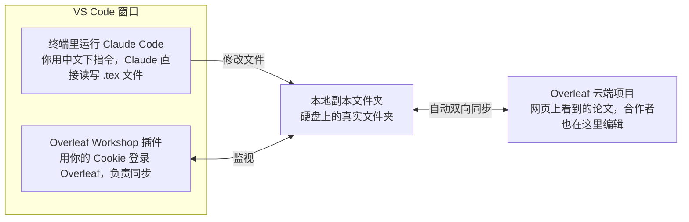

# 保姆级教程：让 Claude 直接编辑你的 Overleaf 论文（VS Code + 终端 + Claude Code）

2026-11-11 · Jianxiang He

## 为什么要折腾这一套

打通之后，你在终端里对 Claude 说一句"帮我润色 Introduction 第二段"，它会直接打开你论文的 .tex 文件改好，改动会自动同步到 Overleaf 网页里，全程不用复制粘贴。

以前的流程是这样的：在 Overleaf 里选中一段，复制到 Claude 网页，等它改完，再一句一句粘回去；或者让 Claude 写一个表格、一段 related work，再找位置粘进 Overleaf。段落一多就容易贴错位置、漏改、把 LaTeX 命令弄坏，而且 Claude 每次只看到你贴的那几句，不知道整篇论文前后文。

这套工作流解决的就是这件事：让 Claude 能直接看到并修改整个 Overleaf 项目。下面先讲清楚四个东西的关系，再一步一步操作，新手照着做就能跑通。

## 先搞懂：四样东西是什么关系

一句话：Claude 改的是你电脑硬盘上的文件，插件负责把这些文件和 Overleaf 保持一致。



- Overleaf 项目：存在 Overleaf 服务器上的论文，网页里看到、合作者一起编辑的就是它。
- VS Code：一个编辑器，可以理解成一张工作台。它本身不认识 Overleaf，装上 Overleaf Workshop 插件后才能连上。
- 终端：VS Code 下方那个敲命令的窗口。它打开时自动位于当前项目文件夹，在这里运行的程序都对这个文件夹生效。
- Claude Code：在终端里运行的 Claude。和网页版的区别是，它能直接读写当前文件夹里的文件，不用你复制粘贴。

整条链路就是：你在终端里给 Claude 下指令 → Claude 修改本地 .tex 文件 → 插件把改动同步到 Overleaf → 你在网页上点 Recompile 看 PDF。

## 准备工作

开始前确认下面四样东西都有了。

| 要准备的 | 说明 |
| --- | --- |
| Overleaf 账号 | 免费账号就行，本教程的主方案不需要 Overleaf 付费 |
| VS Code | 到 code.visualstudio.com 下载安装 |
| Claude 付费账号 | Claude Code 需要 Pro、Max、Team、Enterprise 或 Console 账号，免费版不包含 Claude Code（[官方安装文档](https://code.claude.com/docs/en/setup)） |
| Claude Code | 安装方法见下方 |

安装 Claude Code，打开系统自带的终端，按你的系统复制一行运行：

```bash
# macOS / Linux / WSL
curl -fsSL https://claude.ai/install.sh | bash

# Windows PowerShell
irm https://claude.ai/install.ps1 | iex
```

装完后运行 `claude --version`，能打印出版本号就说明装好了。Windows 用户官方建议另外装一个 Git for Windows。

## 第一步：装 Overleaf Workshop 插件并登录

这一步的目的是让 VS Code 能以你的身份连上 Overleaf。用到的是开源插件 [Overleaf Workshop](https://github.com/iamhyc/overleaf-workshop)。

1. 打开 VS Code，点左侧栏的扩展图标（四个小方块），搜索 `Overleaf Workshop`，作者是 iamhyc，点 Install。
2. 装好后左侧栏会多出一个 Overleaf 图标，点开它，选择登录。overleaf.com 开了验证码，邮箱密码登录通常走不通，要选 Login with Cookies。
3. 拿 Cookie：用浏览器正常登录 Overleaf，按 F12 打开开发者工具，切到 Network（网络）标签，然后刷新 `https://www.overleaf.com/project` 这个页面。
4. 在 Network 的筛选框里输入 `/project`，点名字正好是 `project` 的那一条请求，在 Request Headers 里找到 Cookie，把它的值整段复制下来，形如 `overleaf_session2=...`。
5. 粘贴到 VS Code 的登录输入框里回车。成功后左侧会列出你在 Overleaf 上的所有项目。

Cookie 等于你的登录凭证，不要发给别人，也不要截图发到网上。登录方法来自插件[官方文档](https://raw.githubusercontent.com/iamhyc/Overleaf-Workshop/master/docs/wiki.md)。

## 第二步：把项目拉到本地（Local Replica）

这一步最关键：必须用 Open Project Locally 建一个本地副本，而不是直接在插件里点开项目。

原因是：直接点开时，插件显示的是一个"虚拟文件夹"，文件其实还在 Overleaf 服务器上，硬盘上并没有。终端和 Claude Code 只能读写硬盘上真实存在的文件，所以它们看不到虚拟文件夹；有用户就报告过 Claude Code 在这种虚拟工作区里用不了（[issue 记录](https://claudeissues.com/issue/35095-bug-claude-vscode-extension-not-loading-with-overleaf-workshop-extension)）。本地副本则是硬盘上的一个普通文件夹，插件负责把它和 Overleaf 保持同步。

1. 在 VS Code 左侧 Overleaf 面板里，右键你要改的项目，选 `Open Project Locally...`。
2. 弹窗问你放在哪里时，选一个父文件夹，比如 `~/papers`，点右上角 `Check` 确认。
3. 插件会在 `父文件夹/项目名` 建立副本。如果这个路径已经存在，会被直接覆盖，所以别选一个里面有重要东西的同名文件夹。
4. 建好后再选中这个副本文件夹打开，VS Code 窗口就切到了本地项目。

建好的副本长这样：

```text
~/papers/my-paper/          ← 本地副本，硬盘上的真实文件夹
├── .overleaf/
│   └── settings.json      ← 插件记录这个文件夹对应哪个 Overleaf 项目，别删
├── main.tex
├── sections/
│   ├── intro.tex
│   └── method.tex
├── figures/
└── refs.bib
```

打开后 VS Code 底部状态栏会出现本地副本的同步状态，点它（或者在命令面板运行 Configure Source Control）可以临时暂停同步、设置哪些文件不同步。本地副本里默认不能编译和预览 PDF，看效果还是回 Overleaf 网页点 Recompile 最省事。

## 第三步：在 VS Code 终端里叫出 Claude

现在 VS Code 打开的就是本地副本文件夹，这一步让 Claude 在这个文件夹里干活。

1. 在 VS Code 菜单栏选 终端 → 新建终端（快捷键 Ctrl + `），窗口下方会弹出一个终端。它的当前位置自动就是这个项目文件夹。
2. 确认位置对不对：输入下面的命令，能看到 main.tex 这些文件就对了。
3. 输入 `claude` 回车启动。第一次会弹出浏览器让你登录 Claude 账号，还会问你是否信任这个文件夹，选信任。

```bash
ls          # Windows PowerShell 也可以用 ls
claude
```

然后做一个最小测试，确认整条链路通了：

1. 对 Claude 说："在 main.tex 的 `\begin{document}` 下一行加一句注释 `% sync test`"。
2. Claude 会先展示它要改什么，并问你是否允许修改文件，同意即可。
3. 打开浏览器里的 Overleaf 项目，看 main.tex 里是否出现了这行注释。出现了，说明 Claude → 本地文件 → Overleaf 这条路全通。
4. 反过来在 Overleaf 网页上删掉这行注释，再看本地 main.tex 里是否也消失了，这是在确认反方向的同步。

## 日常怎么用

跑通之后，每次写论文只需要：用 VS Code 打开本地副本文件夹 → 新建终端 → 输入 `claude`。因为 Claude 能读到整个项目，指令里直接说文件名和章节名就行，不用再贴原文。下面是几类顺手的说法：

```text
# 先让它了解全文
通读一遍这个项目，告诉我论文结构和每个 .tex 文件负责哪一部分

# 润色
sections/intro.tex 第二段读起来啰嗦，帮我改得更紧凑，不要改变意思，不要动 \cite

# 保持前后一致
Method 里我把模块名从 X 改成了 Y，把全文其他地方也统一改掉

# 生成 LaTeX
根据下面这些数字在 sections/exp.tex 里加一个 booktabs 风格的表格：...

# 查错
检查 refs.bib 里有没有被 \cite 了但不存在的 key
```

一个小建议：可以让 Claude 在项目里建一个 CLAUDE.md，写上论文是投哪个会、用英式还是美式拼写、哪些文件不许动，它每次启动都会先读这个文件。不过 CLAUDE.md 也会被同步到 Overleaf，不想让合作者看到的话，可以在同步设置的 ignore patterns 里把它排除。

## 备选方案：Overleaf 官方 Git 集成

如果你或项目所有者有 Overleaf 付费账号（包括学校团体订阅），可以不装插件，用官方 Git 功能把项目拉到本地，Git 集成是 Overleaf 的付费功能（[官方说明](https://overleaf.com/learn/how-to/Git_integration)）。和主方案的区别是它不会自动同步，改完要手动推送。

1. 在 Overleaf 项目左侧菜单选 Git，复制弹窗里的 clone 命令。
2. 第一次会提示生成 Git 令牌（token），存好它；也可以在账号设置里生成。
3. 在终端里运行 clone 命令，提示用户名时填 `git`，提示密码时粘贴 token（[官方说明](https://cn.overleaf.com/learn/how-to/Git_integration_authentication_tokens)）。
4. 用 VS Code 打开拉下来的文件夹，同样在终端里启动 `claude`。
5. 改完之后把改动推回 Overleaf，开工前先拉一下合作者的改动。这两件事也可以直接交给 Claude，跟它说"提交并推送到 Overleaf"即可。

```bash
# 项目网址 https://www.overleaf.com/project/1234567 对应：
git clone https://git.overleaf.com/1234567 my-paper

# 开工前：拉取合作者的改动
git pull

# 收工时：推送你的改动
git add -A
git commit -m "polish intro"
git push
```

Git 方案的好处是每次改动都有记录、改坏了容易退回；代价是要付费，而且要记得 pull 和 push。

## 常见问题与避坑

| 问题 | 原因和办法 |
| --- | --- |
| Claude 说找不到文件，或者改了没同步 | 大概率是在虚拟文件夹里开的终端。回到第二步，用 Open Project Locally 打开本地副本，再开终端 |
| 登录失败或过一阵子要重新登录 | Cookie 会过期。照第一步重新复制一次 Cookie 登录 |
| 和合作者同时改了同一段 | 同步可能冲突。合作者在线编辑时，让 Claude 只动你负责的文件或章节 |
| 网络不稳时同步异常 | 插件文档自己说本地副本功能还不算稳定，网络不稳时可能出问题。重要改动后去 Overleaf 网页确认一眼 |
| 编译产生的 .aux .log 等文件也被传上去 | 在同步设置的 ignore patterns 里排除它们 |
| 建副本时文件夹被覆盖 | 副本路径已存在时会被覆盖，选一个空的父文件夹 |

另外两条习惯：一是大改之前在 Overleaf 的 History 里给当前版本打个标签，改坏了能退回；二是 Claude 每次改文件前都会展示改动，花十几秒看一眼再同意，尤其留意它有没有编造数字或引用。

## 参考来源

- [Overleaf Workshop 插件仓库](https://github.com/iamhyc/overleaf-workshop)
- [Overleaf Workshop 文档：登录与 Local Replica](https://raw.githubusercontent.com/iamhyc/Overleaf-Workshop/master/docs/wiki.md)
- [Claude Code 安装文档](https://code.claude.com/docs/en/setup)
- [Overleaf Git 集成](https://overleaf.com/learn/how-to/Git_integration)
- [Overleaf Git 令牌说明](https://cn.overleaf.com/learn/how-to/Git_integration_authentication_tokens)
