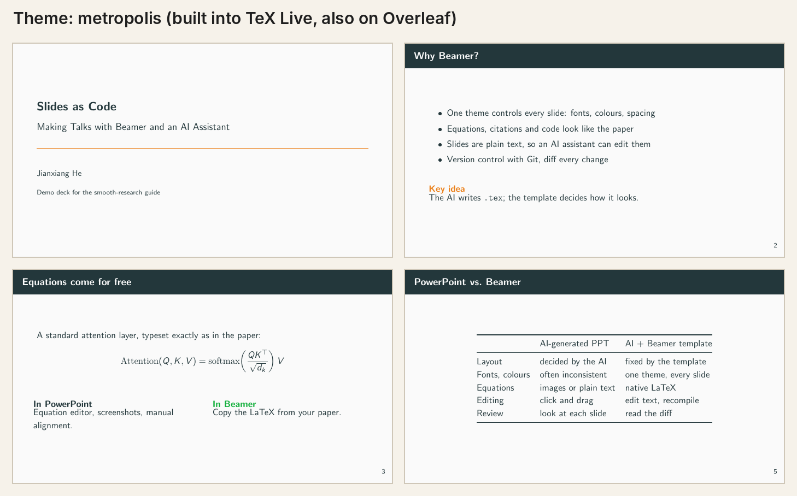
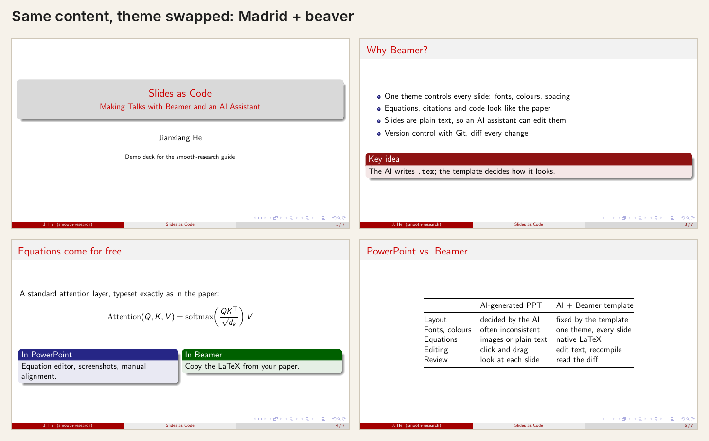

# 让 AI 做的汇报 PPT 不再有"AI 味"：用 Beamer 把幻灯片变成代码

2026-11-18 · Jianxiang He · 演示源码：[examples/03-beamer/demo-metropolis.tex](../examples/03-beamer/demo-metropolis.tex)

## 解决什么问题

我试过很多次直接让 AI 做 PPT，问题主要有两个。一是容易出错：排版跑偏、每页字体和颜色不统一、公式变成截图或者干脆变成纯文本，改一处又要从头检查一遍。二是"AI 味"很重：大色块渐变、emoji、每页四张卡片，课程汇报或者正式的学术报告用这种 PPT，很容易被说不专业。

我的解法是改用 Beamer。Beamer 是 LaTeX 的幻灯片格式，学术报告里很常见，用模板做出来的幻灯片版式规整、风格统一，看起来就比较正式。更关键的是，Beamer 的幻灯片本身就是一份 `.tex` 文本，对 Claude、Codex 这类 AI 来说，做 PPT 就变成了写代码和改代码，而这正是它们最擅长的事：模板管外观，AI 只负责填内容。

## 先搞懂它是怎么工作的

```text
模板（主题 .sty 文件）    ← 决定字体、配色、页眉页脚、logo，这部分 AI 不碰
        +
main.tex（每页一个 frame） ← AI 只改这里：标题、要点、公式、表格、图片
        ↓ 编译（pdflatex 或 xelatex）
slides.pdf               ← 直接拿去讲
```

一页幻灯片在代码里长这样：

```latex
\begin{frame}{Why Beamer?}
  \begin{itemize}
    \item One theme controls every slide: fonts, colours, spacing
    \item Equations, citations and code look like the paper
  \end{itemize}
\end{frame}
```

为什么这套方式适合交给 AI：

| | AI 直接做 PPT | AI + Beamer 模板 |
| --- | --- | --- |
| 版式 | AI 自己设计，每次都不一样 | 模板定死，AI 改不了 |
| 字体、配色 | 经常前后不统一 | 一个主题管所有页 |
| 公式 | 截图或纯文本 | 原生 LaTeX，和论文里一模一样 |
| 修改 | 拖拽、点选 | 改文字，重新编译 |
| 检查 | 一页一页看 | 看代码改动（diff），出错时编译器会报出具体行号 |

## 先看效果

下面两张图是同一份 `.tex` 编译出来的，只换了主题。源码就在本仓库的 [examples/03-beamer](../examples/03-beamer/) 里，可以直接拿去用。

`metropolis` 主题（TeX Live 自带，Overleaf 上也能直接用），简洁现代：



换成 `Madrid` + `beaver` 配色，就是比较传统的学术报告风格：



## 准备工作

| 要准备的 | 说明 |
| --- | --- |
| Overleaf 账号 | 免费账号就能编译 Beamer，不想在本地装 LaTeX 的话最省事 |
| 一个 Beamer 模板 | 学校的模板，或者 metropolis 这类通用主题，第一步讲怎么找 |
| 一个会写代码的 AI | Claude、Codex 都行；如果想让 Claude 直接改 Overleaf 里的文件，配合[第 01 篇](01-claude-code-edit-overleaf.md)的工作流 |
| 本地编译（可选） | 装 TeX Live，用 `latexmk -pdf main.tex` 编译 |

## 第一步：搜"beamer + 学校简写"找模板

最简单的办法就是直接搜"beamer + 你们学校的英文简写"，比如 `THU beamer`、`PKU beamer`。主要去两个地方找：

- Overleaf 的模板库：[overleaf.com/gallery/tagged/beamer](https://www.overleaf.com/gallery/tagged/beamer)，里面有大量按学校风格做的 Beamer 模板，很多学校都能搜到。
- GitHub：搜 `<学校简写> beamer theme`，不少学校有学生维护的版本。

需要注意三点：

1. 这类模板大多是学生自己做的非官方版本，不代表学校官方。正式场合（比如答辩、对外报告）用学校 logo 之前，最好先确认一下学校的品牌规定。
2. 如果搜不到自己学校的，就用通用主题。我搜我们学校时，Overleaf 上只找到了 MBZUAI 的学位论文模板，没有 Beamer 模板，这种情况直接用 `metropolis` 就很好，干净、正式，不会出错。
3. 有学校的 PPT 品牌模板也可以让 AI 照着它的配色和 logo 位置改一版 Beamer 主题，不过这一步改的是主题文件，要单独检查。

## 第二步：把模板变成你自己的项目

在 Overleaf 模板页面点 `Open as Template`，就会复制一份到你自己的账号下。之后有两种用法：

- 让 Claude 直接改：照[第 01 篇](01-claude-code-edit-overleaf.md)的方法，用 VS Code 把这个项目拉到本地，在终端里启动 Claude Code。
- 不想配环境：把 `main.tex` 的内容贴给 AI，让它返回修改后的完整文件，再粘回 Overleaf。

打开项目之后先看一眼文件结构，弄清哪些是模板文件、哪些是你要写的：

```text
my-talk/
├── main.tex            ← 你和 AI 只改这个
├── beamertheme*.sty    ← 模板的主题文件，不要动
├── figures/            ← 放你自己的图
└── refs.bib            ← 参考文献（如果模板带）
```

## 第三步：让 AI 按模板写内容

关键是在指令里讲清楚"只能改哪里、不能做什么"。我常用的指令是这样的：

```text
这是一个 Beamer 模板项目。先读 main.tex 和主题文件，弄清楚它用了哪些命令和环境。
然后按我下面的提纲，在 main.tex 里写一份 10 页左右的演讲：
- 只改 main.tex，不要改主题文件，非必要不要新增宏包
- 每页一个 frame，每页不超过 5 个要点
- 公式直接用 LaTeX 写；图片用 \includegraphics 引用 figures/ 里已有的文件
- 不要编造数字、实验结果和参考文献，缺的地方写 [TODO]
提纲：
1. ……
2. ……
```

内容是中文的话，要多加一句"用 ctex 宏包并改用 XeLaTeX 编译"，因为 Beamer 默认的 pdflatex 编译不了中文。

## 第四步：编译、检查、迭代

1. 在 Overleaf 点 `Recompile`，或者在本地运行 `latexmk -pdf main.tex`。
2. 看日志里的 `Overfull` 警告，它说明有内容超出了页面边界。可以直接把日志丢给 AI："把 log 里所有 Overfull 警告修掉，不要删内容，优先拆页或缩短措辞"。
3. 要改某一页时，直接说"第 4 页的表格改成三列""把第 2 页拆成两页"。AI 只改那一个 frame，其他页面不会被动到。

## 常见问题

| 问题 | 原因和办法 |
| --- | --- |
| 中文显示不出来或者编译报错 | 需要 `\usepackage{ctex}` 并用 XeLaTeX 编译；在 Overleaf 的项目设置里把 Compiler 改成 XeLaTeX |
| 内容超出页面 | 看日志里的 `Overfull` 警告，让 AI 拆页或精简，不要缩小字号硬塞 |
| AI 把模板样式改乱了 | 指令里写明"不要改主题文件"；改坏了在 Overleaf 的 History 里退回 |
| AI 编了数据或引用 | 指令里要求缺的地方写 `[TODO]`，交稿前逐页核对数字和参考文献 |
| 模板里的字体或宏包找不到 | 有些主题需要 XeLaTeX 或额外字体，先按模板 README 说的编译器来；`metropolis` 用 pdflatex 也能编译，只是会退回默认字体 |
| 学校 logo 能不能用 | 非官方模板不代表学校认可；正式场合先查学校的品牌规定 |

## 参考来源

- [Overleaf 模板库：Beamer](https://www.overleaf.com/gallery/tagged/beamer)
- [MBZUAI 品牌资源页](https://mbzuai.ac.ae/brand/)
- [metropolis 主题（CTAN）](https://ctan.org/pkg/beamertheme-metropolis)
- [Beamer（CTAN）](https://ctan.org/pkg/beamer)
